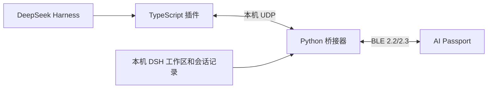

# 架构与数据边界

插件监听任务、工具、结束与提问事件，并作为 `approval/request` 应答者把权限审批转给设备，并自动启动桥接器。桥接器仅绑定回环 UDP，通过 DSH 工作区名单与本地历史补齐未打开的主会话；过滤归档、删除和子代理，实时事件优先。

`whale_v2.py` 把名单、状态、标题、单选/多选/审批题和最近最终回复投影到设备。快照校验完成后才替换名单，回复用会话 ID、桥接器 epoch、修订号与传输分段索引匹配，防止迟到内容进入错误任务。BLE 连接与配对由 `whale_pairing.py` 和固件 BLE 模块处理。

设备应用位于 `main/whale_app.c`，BSP 负责显示、按键、电池与其他硬件。UI 使用 LVGL，任务主页的大幅角色与回复阅读器共用最新会话状态。余额隐藏，真实 Todo 缺失时隐藏进度。

## 回复缓存

电脑端从会话记录提取最近一次最终回复。设备使用约 13 KB RAM 存储 32 个分段，并以三个分段组成阅读滑动窗口。首段优先保留；重复展开已有内容无需再次请求。超长正文被淘汰的部分需重取，缓存部分可在断线时阅读。新回复、会话移除、桥接器 epoch 变化和解绑清理相应缓存，断电全部清空，不写入 NVS。

## 隐私

BLE 传输标题、状态、时间、Todo、单选内容和最近最终回复。它不是只发送无内容的状态灯；回复可能包含用户资料。设备仅应与自己的电脑配对。没有专门传输完整 Prompt 或任意文件的通道；权限审批会带上一行截断到 500 字节的摘要（命令、文件路径或审批理由），回复本身也可能引用这些信息。

API Key 不进入 BLE 或 UDP。余额查询模块仅为旧版兼容保留，R10.1 界面不显示余额，安装时使用 `--skip-key`。本机原始会话、凭据和运行日志不进入源码或发布包。
